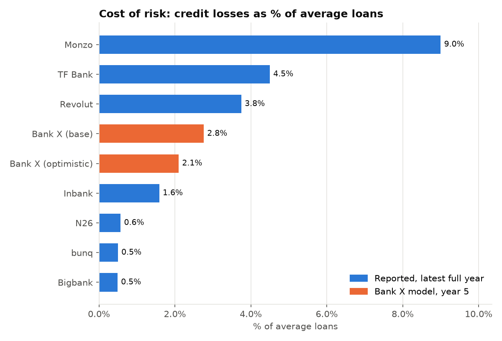

# Digital and consumer-lending banks: public benchmarks vs Bank X

A source-backed benchmark of seven European digital and consumer-lending banks, built from their latest annual reports and compared with year 5 of the [Bank X model](https://github.com/udrism-lang/bank-model). Bank X is a planned deposit-funded digital consumer lender.

Every figure has a source URL and page number. Ratios a company does not publish are computed from its reported lines, and the inputs are shown in the data file. One command produces the table, charts and a single-file HTML report.

Related: [bank-jurisdiction-compare](https://github.com/udrism-lang/bank-jurisdiction-compare), which compares where the same bank could be licensed.

## Key findings

1. **Lending margin, not app scale, drives returns for deposit-funded banks.** The consumer lenders that lend out most of their deposits (Inbank, Bigbank, TF Bank; loans 94-98% of deposits) earn ROE of 12-23% at cost/income of 36-54%. The deposit-heavy neobanks (Monzo, bunq, N26) lend out only 10-37% of deposits and earn 0-7%. Revolut is the exception: 76% of revenue comes from fees, ROE is about 35%, and loans are only 6% of deposits.
2. **Cost of risk is a pricing choice, not a verdict.** TF Bank loses 4.5% of its loans a year and still earns 23% ROE, because it charges about 16%. Bigbank loses only 0.5% but earns just 6.8% on its loans. Loan yield minus cost of risk: TF Bank 11.4%, Inbank 9.5%, Bank X (base) 8.2%, Bigbank 6.3%, Revolut 5.5%.
3. **How Bank X year 5 compares to Inbank today.** Bank X's year-5 loan book of EUR 199m is 16% of Inbank's EUR 1.28bn, with the same pricing (loan yield 11.0% vs 11.1%). ROE is 7.3% vs 12.3% for two reasons:
   - cost of risk is higher, 2.76% vs 1.59%, mostly from day-one IFRS 9 provisions on a fast-growing book;
   - the bank is still sub-scale, with cost/income of 62% vs 54%.

   The optimistic case (ROE 20%, cost/income 46%) would need efficiency between Bigbank (49%) and TF Bank (36%). That is ambitious for a five-year-old bank, but it has been achieved.





## The benchmarks

| Company | Period | Total assets | Loans | Deposits | Net profit | ROE | Cost / income | Cost of risk | Loan yield | Fees / income | Loans / deposits |
|---|---|---|---|---|---|---|---|---|---|---|---|
| Inbank | FY2025 | €1.58bn | €1.28bn | €1.30bn | €19.2m | 12.3% | 54.4% | 1.6% | 11.1% | -5.1% | 98% |
| Bigbank | FY2025 | €3.32bn | €2.71bn | €2.88bn | €37.9m | 13.3% | 48.6% | 0.5%* | 6.8% | 9.3%* | 94% |
| TF Bank | FY2025 | SEK 29.1bn | SEK 23.7bn | SEK 24.7bn | SEK 667m | 23.1% | 36.3% | 4.5% | 15.9%* | 7.6%* | 96% |
| Revolut | FY2025 | £43.0bn | £2.24bn | £36.1bn | £1.30bn | 35.0%* | 51.0%* | 3.8%* | 9.3%* | 76% | 6% |
| Monzo | FY to Mar-2026 | £27.6bn | £2.63bn | £25.7bn | £86m | 6.9%* | 74.0% | 9.0% | n/a | 26.8%* | 10% |
| bunq | FY2025 | €9.05bn | €2.53bn | €8.43bn | €22.4m | 5.0%* | 78.0%* | 0.5%* | n/a | 24.2%* | 30% |
| N26 | FY2025 | €11.1bn | €3.93bn | €10.6bn | €1.6m | 0.4%* | 93.9%* | 0.6%* | n/a | 48.0%* | 37% |
| **Bank X (base), year 5** | model | €266m | €199m | €243m | €1.6m | 7.3% | 61.6% | 2.8% | 11.0% | 10.4% | 82% |
| **Bank X (optimistic), year 5** | model | €305m | €241m | €271m | €6.4m | 20.4% | 45.6% | 2.1% | 11.5% | 11.3% | 89% |

\* Computed from reported figures, because the company does not publish the ratio. Inputs and page numbers are in [`data/benchmarks.yaml`](data/benchmarks.yaml). The HTML report also has equity, total income, NIM and customer counts.

## Things the reports do not make obvious

- **bunq's "EUR 85.3m net profit" for 2024 was profit before tax.** The annual report text calls it net profit, but the income statement shows EUR 85.3m as result before tax and EUR 63.6m as result for the period. In 2025, net profit fell to EUR 22.4m.
- **Inbank's net fee income is negative** (-EUR 4.4m in 2025). Fee expense exceeds fee income, so its earnings are almost entirely interest and rental margin.
- **Revenue is not comparable across these banks.** Revolut and Monzo report gross revenue (before fee and interest expense). This table uses net total income for every bank, so cost/income is measured the same way.
- **Customer counts measure different things.** bunq counts 22m "users on the platform", N26 counts 5.6m "revenue-relevant customers", and Monzo 15m customers, of whom 10.4m are monthly active.

## Comparability

- Periods: calendar 2025 for all except Monzo (year to 31 March 2026).
- Currencies: amounts stay in the reporting currency. Sizes are converted to EUR only for the "Assets EUR bn" console column, at ECB reference rates on 31.12.2025. Ratios are never converted.
- NIM definitions differ (average interest-earning assets vs average total assets), so NIM is shown in the HTML report but not used in the findings.
- Bank X cost of risk includes day-one IFRS 9 provisions on new lending, which are high while the loan book grows fast. Its underlying assumption is 2.0%.
- One value is flagged `needs_check`: TF Bank's 3.4m customers, which come from the results presentation rather than the year-end report.

## Run it

Requires Python 3.10+.

**Windows (PowerShell):**

```powershell
.\run.ps1
```

**Any platform:**

```bash
pip install -r requirements.txt
pytest -q
python run.py
```

Outputs in `output/`: `report.html` (findings, full table with the source note for each value on hover, charts and a list of sources), `summary.md` and three charts.

## Project structure

```
data/benchmarks.yaml     every value with source URL, page and note; FX rates with ECB source
benchmarks/data.py       load, validate, FX conversion, derived ratios
benchmarks/findings.py   the three findings, computed from the data so they stay in sync
benchmarks/report.py     charts, markdown summary, single-file HTML report
run.py                   command-line entry point
tests/                   data quality and consistency tests
docs/                    charts used in this README
```

## Tests

- every value has a source or a `needs_check` flag, and a missing value has a note explaining why;
- ratios are stored as decimals (catches "12.3" typed instead of "0.123");
- loans and equity never exceed total assets;
- each reported ROE is consistent with net profit / equity;
- FX conversion applies to amounts only, never to ratios;
- derived ratios are computed correctly;
- the Bank X rows are marked as model output, not reported results.

## Next steps

- Add Lunar, Klarna and Nordic consumer lenders (Resurs, Norwegian), plus quarterly updates.
- Cohort-level comparisons where banks disclose vintages.
- Pull the Bank X rows straight from bank-model instead of copying them.

---

Built with AI-assisted development (Claude): research agents extracted figures from the annual report PDFs; each figure is recorded with its page reference in `data/benchmarks.yaml`, and the tests check the figures for internal consistency.
