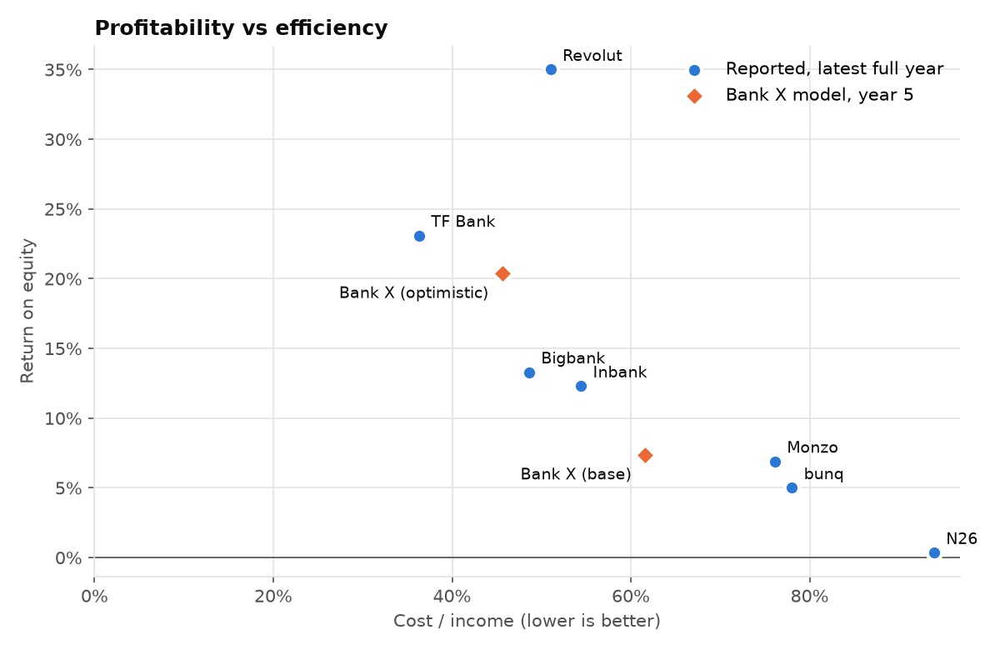
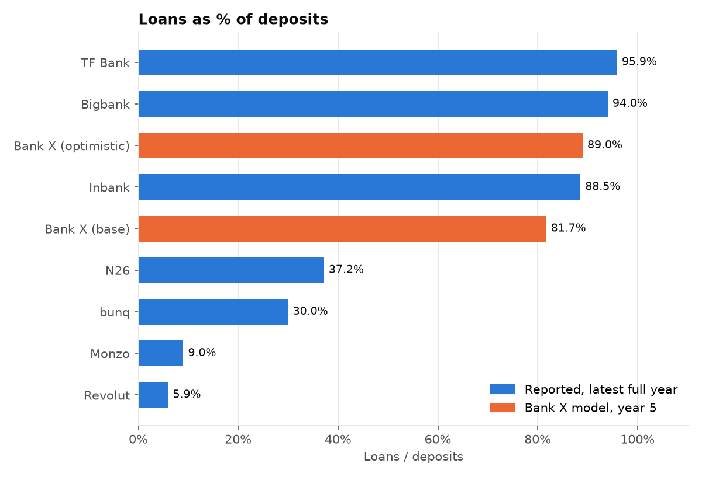

# Digital banks and deposit-funded lenders: public benchmarks vs Bank X

A source-backed benchmark of seven European digital banks and deposit-funded lenders, compared with year 5 of the [Bank X model](https://github.com/udrism-lang/bank-model). Bank X is a planned deposit-funded digital consumer lender.

The figures come from each bank's audited annual report for 2025 (Monzo: year to March 2026). A few values come from other sources, and the data file says so: Inbank's ROE figures (Q4 2025 interim report), TF Bank's customer count (results presentation) and N26's customer count (press release).

Every value has a source URL. Most also have a page number. Ratios a company does not publish on the same basis are computed from its reported lines, and the data file lists the inputs. Customer counts and the Bank X rows have no page number. One command produces the table, charts and a single-file HTML report.

Related: [bank-jurisdiction-compare](https://github.com/udrism-lang/bank-jurisdiction-compare), which compares where the same bank could be licensed.

## Key findings

1. **In this sample, the banks that lend out most of their deposits earned higher returns than the deposit-heavy neobanks.** These deposit-funded lenders (Inbank, Bigbank, TF Bank; loans 89%-96% of deposits) earn ROE of 12%-23% at cost/income of 36%-54%. Monzo, bunq and N26 have loans of only 9%-37% of deposits, and much of that is not consumer lending (bunq EUR 1.46bn mortgages; N26 EUR 1.64bn municipal loans and EUR 1.96bn mortgages). They earn ROE of 0%-7%. Revolut does not fit this pattern: it has the highest ROE (35%) with loans of only 6% of deposits, because net fees are 73% of its net income. Seven banks are too few to show cause and effect.
2. **Cost of risk reflects what a bank lends and how it prices it.** TF Bank loses 4.5% of its loans a year and still earns 23% ROE, because its loans yield about 15%. Bigbank loses only 0.5% and earns 6.8% on loans, mainly because most of its book is business and home loans, largely secured on real estate; unsecured consumer loans are only 31% of its portfolio. Loan yield minus cost of risk: TF Bank 10.8%, Inbank 9.2%, Bank X (base) 8.2%, Bigbank 6.3%, Revolut 5.5%. This spread is approximate (the loan bases differ slightly between banks) and is before funding cost.
3. **How Bank X year 5 compares to Inbank today.** A loan book of EUR 199m is 17% of Inbank's EUR 1.15bn. Loan pricing is the same by assumption: Bank X's loan yield of 11.0% is calibrated to Inbank's 11.0%. ROE is 7.3%, against 11.2% for Inbank's core business (12.3% reported, which includes a one-off gain from the reassessment of Polish tax assets). The gap has two causes: cost of risk is higher (2.76% vs 1.76%, mostly day-one IFRS 9 provisions on a fast-growing book), and the bank is still sub-scale (cost/income 62% vs 54%). The optimistic case (ROE 20%, cost/income 46%) would need efficiency between Bigbank (49%) and TF Bank (36%). That is ambitious for a five-year-old bank, but larger banks in this sample have achieved it.






## The benchmarks

| Company | Period | Total assets | Loans | Deposits | Net profit | ROE | Cost / income | Cost of risk | Loan yield | Fees / income | Loans / deposits |
|---|---|---|---|---|---|---|---|---|---|---|---|
| Inbank | FY2025 | €1.58bn | €1.15bn | €1.30bn | €19.2m | 12.3% | 54.4% | 1.8%* | 11.0%* | -5.1%* | 88.5% |
| Bigbank | FY2025 | €3.32bn | €2.71bn | €2.88bn | €37.9m | 13.3% | 48.6% | 0.5%* | 6.8% | 9.3%* | 94.0% |
| TF Bank | FY2025 | SEK 29.12bn | SEK 23.68bn | SEK 24.69bn | SEK 667.0m | 23.1% | 36.3% | 4.5% | 15.3%* | 7.6%* | 95.9% |
| Revolut | FY2025 | £43.02bn | £2.15bn | £36.14bn | £1.30bn | 35.0%* | 51.0%* | 3.8%* | 9.3%* | 72.6%* | 5.9% |
| Monzo | FY to Mar-2026 | £27.61bn | £2.31bn | £25.72bn | £86.3m | 6.9%* | 76.1%* | 9.0% | n/a | 28.0%* | 9.0% |
| bunq | FY2025 | €9.05bn | €2.53bn* | €8.43bn | €22.4m | 5.0%* | 78.0%* | 0.5%* | n/a | 24.2%* | 30.0% |
| N26 | FY2025 | €11.11bn | €3.93bn | €10.57bn | €1.6m | 0.4%* | 93.9%* | 0.6%* | n/a | 42.7%* | 37.2% |
| **Bank X (base), year 5** | model | €265.8m | €198.8m | €243.4m | €1.6m | 7.3% | 61.6% | 2.8% | 11.0% | 10.4% | 81.7% |
| **Bank X (optimistic), year 5** | model | €305.4m | €240.8m | €270.6m | €6.4m | 20.4% | 45.6% | 2.1% | 11.5% | 11.3% | 89.0% |

\* Computed from reported figures, because the company does not publish the value on this basis. Inputs and page numbers are in [`data/benchmarks.yaml`](data/benchmarks.yaml). Loans / deposits is computed for every bank. The HTML report also has equity, total income, NIM and customer counts.

## Things the reports do not make obvious

- **bunq's "EUR 85.3m net profit" for 2024 was profit before tax.** The text of bunq's 2024 annual report says "our net profit reached EUR 85,3 million" (p18). Its income statement shows EUR 85.3m as result before tax and EUR 63.6m as result for the period (p63). In 2025, net profit fell to EUR 22.4m.
- **Inbank's net fee income is negative** (-EUR 4.4m in 2025). Fee expense exceeds fee income, so its earnings are almost entirely interest and rental margin.
- **Revenue is not comparable across these banks.** Revolut and Monzo report gross revenue (before fee and interest expense). This table uses total net operating income for every bank. Cost / income and fees / income use it as the denominator. Revolut says fee-based revenues are "76% of our total turnover", which is fee income / gross revenue (p13). On a net basis it is 72.6%.
- **Monzo's reported cost/income of 74% is adjusted.** It excludes GBP 26.3m of one-off costs. The statutory figure used here is 76.1%.
- **Customer counts measure different things.** bunq counts 22m "users on the platform", N26 counts 5.6m "revenue-relevant customers", and Monzo 15m customers, of whom 10.4m are monthly active.

## Comparability

- Periods: calendar 2025 for all except Monzo (year to 31 March 2026).
- Currencies: amounts stay in the reporting currency. Sizes are converted to EUR only in the "Assets EUR bn" column of the console output, at ECB reference rates on 31.12.2025. Ratios are never converted.
- NIM definitions differ (average interest-earning assets vs average total assets), so NIM is shown in the HTML report but not used in the findings.
- Accounting: N26 reports under German GAAP (HGB), not IFRS. All other banks report under IFRS.
- Loans are net loans to customers from each balance sheet. Inbank's figure excludes its rental fleet (Inbank reports a loan and rental portfolio of EUR 1.28bn). N26's loans include EUR 1.64bn municipal loans and EUR 1.96bn mortgages; bunq's include EUR 1.46bn mortgages. Inbank's cost of risk (1.76%) is computed on loans to match its loan yield; Inbank reports 1.59% on the loan and rental portfolio.
- ROE is net profit / average equity, with three exceptions to keep in mind. TF Bank reports ROE on equity excluding its SEK 250m Tier 1 instrument (22.0% on total equity). Inbank's 12.3% includes a one-off gain on Polish tax assets (core 11.2%). Monzo paid tax of about 1% of profit, so its ROE is not comparable with fully taxed banks.
- Loan yield is interest income on customer loans / average loans. Bigbank's "return on loans" uses the same definition. Loan bases differ slightly (net or gross loans), so loan yield minus cost of risk is approximate. It is also before funding cost.
- Bank X cost of risk includes day-one IFRS 9 provisions on new lending, which are high while the loan book grows fast. Its underlying assumption is 2.0%.
- One value is flagged `needs_check`: TF Bank's 3.4m customers, which come from the results presentation rather than the annual report.

## Run it

Requires Python 3.10+.

**Windows (PowerShell):**

```powershell
.\run.ps1
```

**Any platform:**

```bash
pip install -r requirements.txt
pytest -q
python run.py
```

Outputs in `output/`: `report.html` (findings, full table with the source note for each value on hover, charts and a list of sources), `summary.md`, `readme_table.md` (the table above) and three charts. Copy the charts to `docs/` to update this README.

## Project structure

```
data/benchmarks.yaml     every value with source URL, note and (where available) page; FX rates with ECB source
benchmarks/data.py       load, validate, FX conversion, derived ratios
benchmarks/findings.py   the three findings, computed from the data so they stay in sync
benchmarks/report.py     charts, markdown summary, single-file HTML report
run.py                   command-line entry point
tests/                   data quality and consistency tests
docs/                    charts used in this README
```

## Tests

- every value has a source or a `needs_check` flag, and a missing value has a note explaining why;
- ratios are stored as decimals (catches "12.3" typed instead of "0.123");
- loans and equity never exceed total assets;
- each ROE is within 1 percentage point of net profit / average equity, using opening and closing equity from the reports (TF Bank is checked on its stated basis, equity excluding its Tier 1 instrument);
- every fee share uses net fee income;
- FX conversion applies to amounts only, never to ratios;
- derived ratios are computed correctly;
- the Bank X rows are marked as model output, not reported results.

## Next steps

- Add Lunar, Klarna and Nordic consumer lenders (Resurs, Norwegian), plus quarterly updates.
- Cohort-level comparisons where banks disclose vintages.
- Pull the Bank X rows straight from bank-model instead of copying them.

---

Built with AI-assisted development (Claude): research agents extracted figures from the annual report PDFs; each figure is recorded with its source and, where available, page in `data/benchmarks.yaml`, and the tests check the figures for internal consistency.
